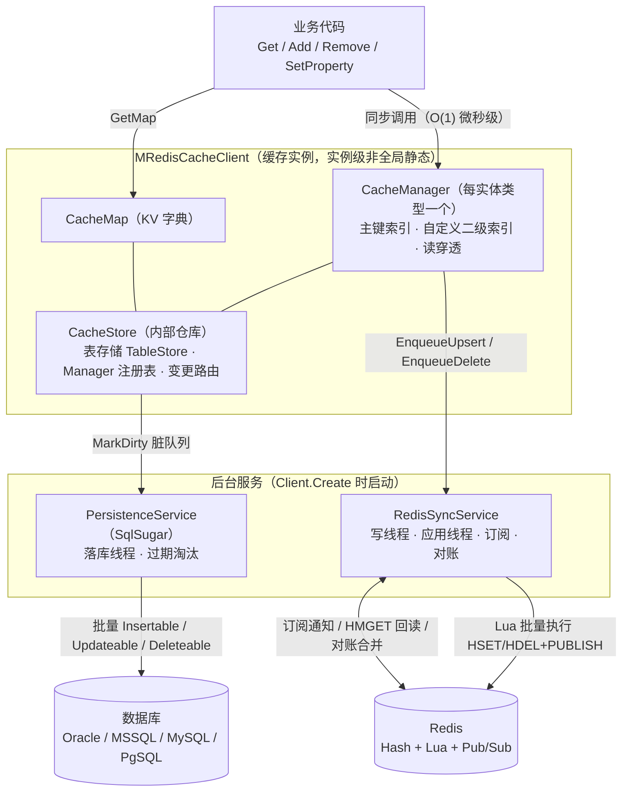
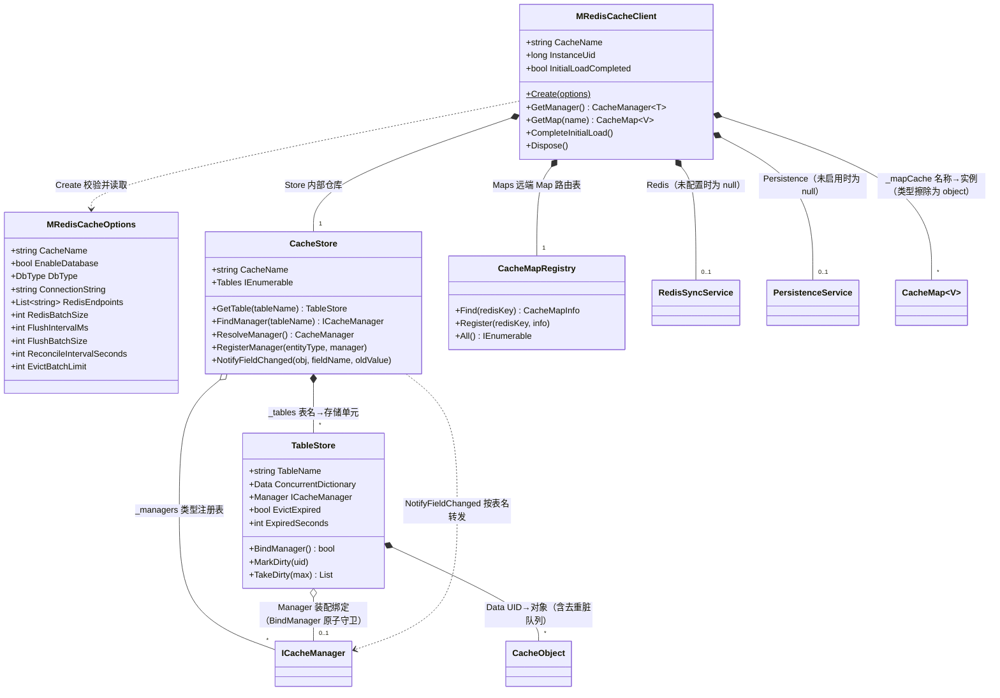
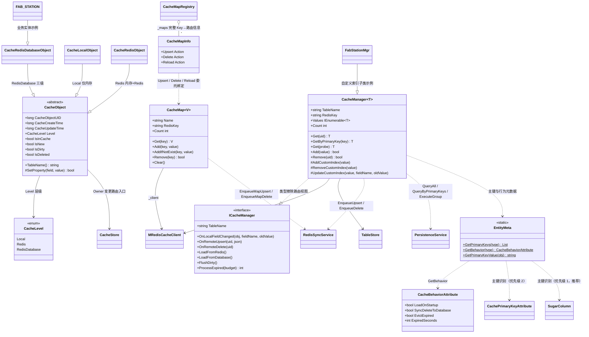
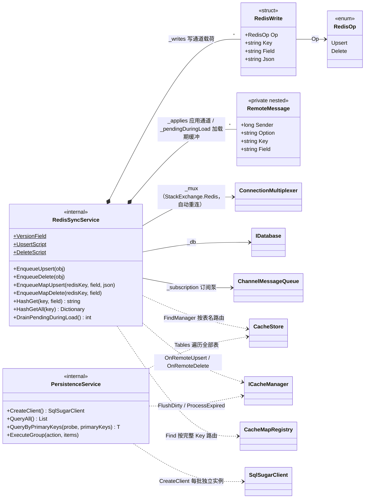
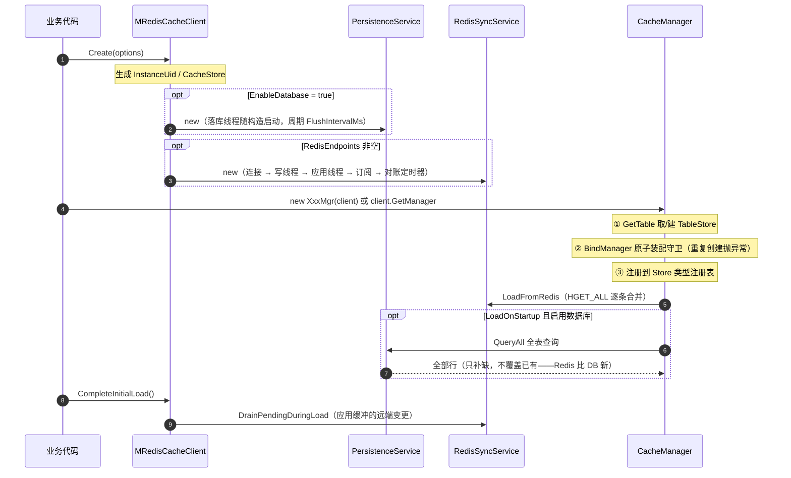
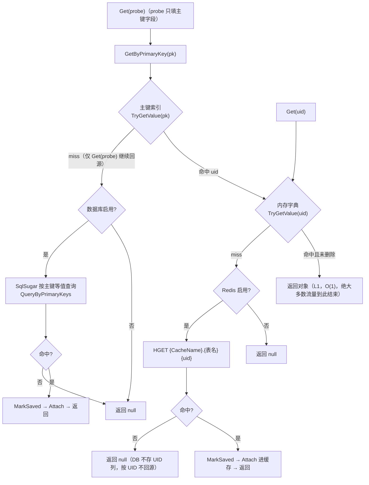
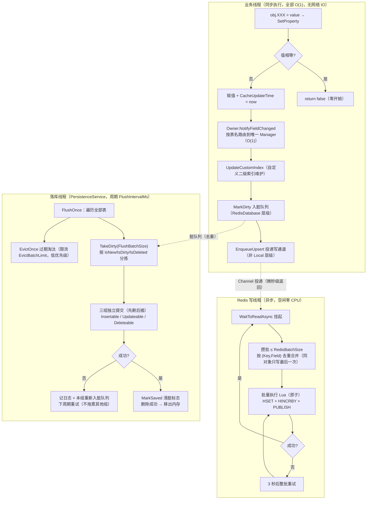
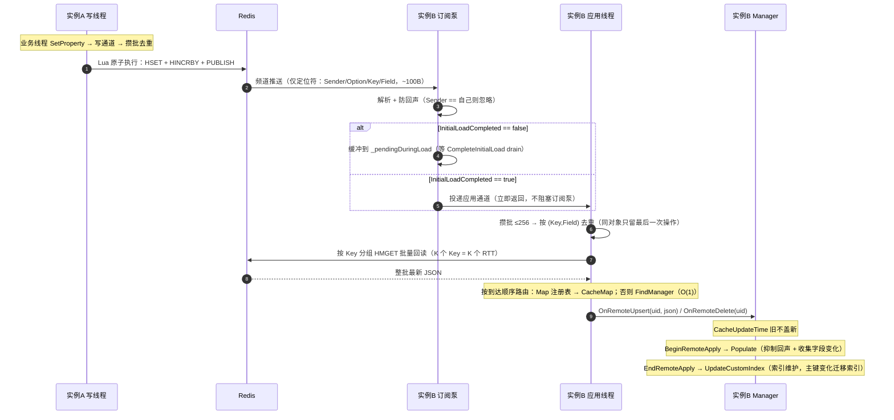
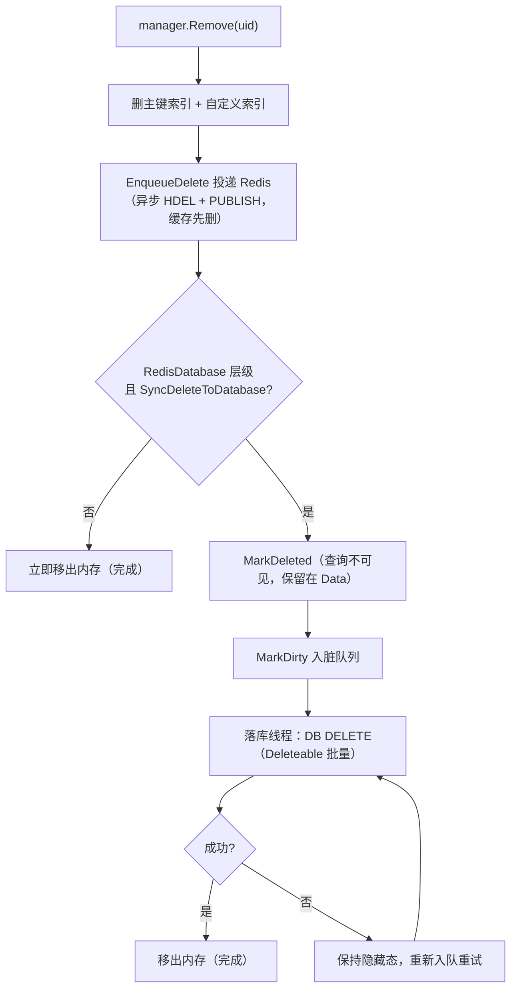
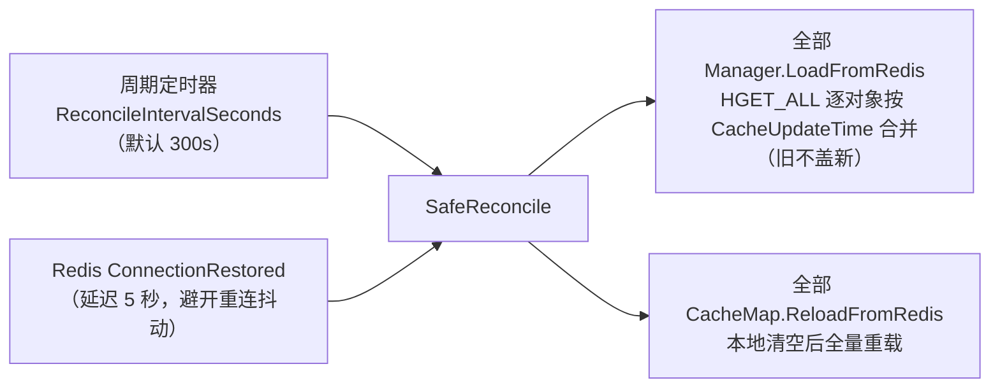

# MRedisCache 架构文档

> 版本：1.0　|　目标：替代旧版 `LibraryAssemble/MCache.*`，修复其数据正确性 / 并发 / 可维护性缺陷
> 数据库层：**SqlSugar ORM**（不再手写 SQL / SourceGenerator 生成 SQL）　|　缓存层：内存 + Redis（StackExchange.Redis）

---

## 1. 概述

MRedisCache 是一个三级缓存中间件：

```
L1 本地内存（ConcurrentDictionary）  ←—— 业务代码直接读写，微秒级
L2 Redis（Hash + Lua + Pub/Sub）     ←—— 多实例共享与变更通知
L3 数据库（SqlSugar，write-behind）  ←—— 落库线程批量异步持久化
```

业务代码只操作内存对象；属性修改自动进入三个通道：**自定义索引维护 → Redis 异步写入 → 脏数据落库**。

### 1.0 总体架构图



### 1.1 工程结构

```
MRedisCache/
├── MRedisCache.sln
├── ARCHITECTURE.md                        ← 本文档
├── MRedisCache.Core/                        ← 核心库（netstandard2.0 / netstandard2.1 双目标）
│   ├── MRedisCacheClient.cs                 ← 缓存实例入口（实例级，非全局静态）
│   ├── MRedisCacheOptions.cs                ← 配置项
│   ├── Attributes.cs                      ← CachePrimaryKey / CacheBehavior 特性
│   ├── CacheObject.cs                     ← 缓存实体基类（SetProperty / 状态标记 / 远端应用）
│   ├── CacheStore.cs                      ← 内部仓库：TableStore + Manager 注册表 + 变更路由
│   ├── CacheManager.cs                    ← 泛型 Manager：索引 / 读穿透 / 写路径 / 落库
│   ├── ICacheManager.cs                   ← Manager 非泛型路由接口
│   ├── CacheMap.cs                        ← Redis 同步字典（CacheMap<V> + 注册表）
│   ├── Redis/RedisSyncService.cs          ← 异步写队列 + Lua 原子发布 + 订阅回读 + 对账
│   ├── Persistence/PersistenceService.cs  ← SqlSugar write-behind 落库线程 + 过期淘汰
│   ├── Internal/EntityMeta.cs             ← 实体元数据缓存（主键/行为/编译后的取值委托）
│   ├── Internal/JsonUtil.cs               ← 统一 JSON（settings 真正传入）
│   ├── Internal/UniqueIdGenerator.cs      ← 63 位 ID 生成器 + UnixTime
│   └── Logging/Log.cs                     ← 日志门面（单一 API）
└── MRedisCache.Demo/                        ← 控制台示例（net8.0）
    └── Program.cs
```

### 1.2 目标框架兼容性

| Core 目标框架 | SqlSugarCore 版本 | 可被引用的工程 |
|---|---|---|
| netstandard2.0 | 5.0.2.9（最后一个支持 2.0 的版本） | .NET Framework 4.7.2 / 4.8 老工程 |
| netstandard2.1 | 5.1.4.221（新版） | net6 / net8 新工程 |

两套目标框架下使用的 SqlSugar 公共 API（`Queryable / Insertable / Updateable / Deleteable / SugarColumn`）完全一致，业务代码无感知。

### 1.3 类关系图

三张类图的成员与关系均与实际代码一一对应（泛型写作 `CacheManager~T~` / `CacheMap~V~`）；图例统一如下：

| 记号 | 含义 | 典型示例 |
|---|---|---|
| `A *-- B` | 组合：B 的生命周期归 A | Client → 两个后台服务（Dispose 反向关闭） |
| `A o-- B` | 聚合：A 持有 B 的引用，不掌管生命周期 | TableStore → Manager 装配绑定 |
| `A --> B` | 关联：字段引用 | CacheManager._client → MRedisCacheClient |
| `A ..> B` | 依赖：方法调用 | Manager → RedisSyncService.EnqueueUpsert |
| `A --|> B` | 继承 | CacheRedisDatabaseObject → CacheObject |
| `A ..|> B` | 实现接口 | CacheManager&lt;T&gt; → ICacheManager |

`JsonUtil / UniqueIdGenerator（含 UnixTime） / Log` 为全局静态工具门面，被全部核心类调用，图中省略以保持可读。

**图 A：实例装配关系（谁创建谁、谁持有谁，与 Create / Dispose 装配顺序一致）：**



要点：

- 两个后台服务的创建时机在 `MRedisCacheClient.Create`（PersistenceService 先于 RedisSyncService 装配，Dispose 反向先停前者）；
- `CacheMap<V>` 在 Client 中以 `object` 类型擦除缓存（`_mapCache`），远端变更路由靠 `CacheMapRegistry`（完整 Redis Key → 委托）；
- `TableStore.Manager`（BindManager 原子守卫）与 `CacheStore._managers`（类型注册表）指向同一批 Manager 实例——前者管"这张表归谁"，后者管"这个类型归谁"。

**图 B：业务交互面（实体层级 · Manager · Map · 元数据——业务代码只接触这张图里的公开类）：**



要点：

- 业务代码可见的类只有：`MRedisCacheClient`、`CacheManager<T>`（或其子类）、`CacheMap<V>`、三个实体基类与两个特性；其余全部 internal；
- 实体属性 setter 经 `SetProperty → Owner（CacheStore）` 按表名路由回所属 Manager，图中 `CacheObject --> CacheStore` 即这条回路的入口（本地写路径 3.3 的第 1 步）；
- `EntityMeta` 为静态缓存：反射只在类型首次使用时做一次，主键取值编译为委托（见 2.对照表 #17）。

**图 C：后台服务内部结构（通道 · 线程 · 载荷 · 外部连接）：**



要点：

- `RedisWrite` 是业务线程 → 写线程的传递单元（序列化在入队时完成，捕获变更时刻快照）；`RemoteMessage` 是订阅频道上的定位符（~100B，不带数据本体，防回声靠 Sender）；
- `PersistenceService` 每轮批量操作通过 `CreateClient()` 创建独立的短生命周期 `SqlSugarClient`（IsAutoCloseConnection），不长期持有连接。

**关系速查表（与代码字段一一对应）：**

| 持有/调用方 | 被持有/被调方 | 关系 | 代码位置 |
|---|---|---|---|
| MRedisCacheClient | CacheStore | 组合 1:1 | 私有构造 → `Store` |
| MRedisCacheClient | RedisSyncService / PersistenceService | 组合 0..1 | `Create` 装配 / `Dispose` 关闭 |
| MRedisCacheClient | CacheMapRegistry / CacheMap&lt;V&gt; | 组合 | `Maps` / `_mapCache` / `CreateMap` |
| CacheStore | TableStore | 组合 1:N | `_tables` + `GetTable` |
| CacheStore | ICacheManager | 聚合 | `_managers` + `RegisterManager` |
| TableStore | ICacheManager | 聚合 0..1 | `Manager` + `BindManager` 原子守卫 |
| TableStore | CacheObject | 组合 1:N | `Data` 字典 + 去重脏队列 |
| CacheObject | CacheStore | 关联 | `Owner`（Attach 时挂接） |
| CacheManager&lt;T&gt; | MRedisCacheClient / TableStore | 关联 | `_client` / `_table` |
| CacheManager&lt;T&gt; | RedisSyncService | 依赖 | `EnqueueUpsert / EnqueueDelete` |
| CacheManager&lt;T&gt; | PersistenceService | 依赖 | `QueryAll / QueryByPrimaryKeys / ExecuteGroup` |
| CacheManager&lt;T&gt; | EntityMeta | 依赖 | 静态构造 + 主键索引 / 落库分拣 |
| CacheMap&lt;V&gt; | RedisSyncService | 依赖 | `EnqueueMapUpsert / EnqueueMapDelete` |
| CacheMapInfo | CacheMap&lt;V&gt; | 依赖（委托） | `CreateMap` 注册三个回调 |
| RedisSyncService | CacheStore / CacheMapRegistry / ICacheManager | 依赖 | 应用线程按 Key 路由 |
| PersistenceService | CacheStore / ICacheManager | 依赖 | 落库线程遍历全部表 |
| EntityMeta | CacheBehaviorAttribute / CachePrimaryKeyAttribute / SugarColumn | 依赖 | 主键与行为识别 |

---

## 2. 旧版问题 → 新版修复对照

| # | 旧版问题 | 新版方案 | 代码位置 |
|---|---|---|---|
| 1 | **字段级 HUPT 与整体 JSON 协议不对称**，远端反序列化失败、Redis 数据可能被写坏 | 统一为"整体 JSON"协议：写入只发完整对象；订阅方收到通知后**回读 Redis 最新值**再合并 | `RedisSyncService.Dispatch` |
| 2 | `JsonUtil.FromJson` 创建 settings 但没传给 JsonConvert，多态序列化写出读不回 | `JsonUtil` 统一传入 settings，全局唯一序列化入口 | `Internal/JsonUtil.cs` |
| 3 | `CacheMap.Clear` 先清字典再遍历空字典删 Redis，Redis 残留 | 先快照 keys → 清内存 → 逐个投递 Redis 删除 | `CacheMap.Clear` |
| 4 | `DBRedis.HGET` 中 `vFields.Append` 是 LINQ 扩展不生效 | 新实现不存在该代码路径；HashGet 直接调用 | `RedisSyncService.HashGet` |
| 5 | `Atomic<T>` TryEnter 失败仍无锁读写，非原子 | 删除该类型；需要的原子语义用 `Interlocked` / `lock` 直接实现 | `UniqueIdGenerator` |
| 6 | `DurationRecord.Record` 恒为 0 | 删除该类型 | — |
| 7 | **落库先清脏标志后写库，失败即丢数据**（恢复代码被注释） | 成功后才 `MarkSaved`；失败保留脏标志并重新入队，下周期重试 | `CacheManager.FlushUids` |
| 8 | `processDelete` 失败无处理（TODO） | 删除失败对象保持 IsDeleted 隐藏态并重试，成功后才移出内存 | `CacheManager.FlushUids` |
| 9 | **Manager 守卫是实例字段**，每次 new 重复加载 + 向静态事件重复挂接（泄漏） | `TableStore.BindManager` 用 `Interlocked` 原子装配；重复创建直接抛异常；管理器注册表按类型唯一 | `CacheStore` / `CacheManager` 构造 |
| 10 | `PropertyChanged` 构造 + SetInCache 双重订阅，每次变更执行两遍 | 每对象单一通知路径：`SetProperty → Owner.NotifyFieldChanged → Manager`，无事件多播 | `CacheObject.SetProperty` |
| 11 | 静态 `FieldDataChanged` 广播给全部 Manager（O(#Manager)） | 变更按表名路由到唯一 Manager（O(1)） | `CacheStore.NotifyFieldChanged` |
| 12 | Pub/Sub at-most-once，断线丢消息无对账 | 写入失败自动重试；连接恢复后 5 秒触发全表对账；另有周期对账（默认 5 分钟） | `RedisSyncService.ExecuteWithRetryAsync` / `MRedisCacheClient.SafeReconcile` |
| 13 | 加载期缓冲消息只在下一条消息到达时才处理 | `CompleteInitialLoad` 主动 drain + 2 秒兜底定时器 drain | `RedisSyncService.DrainPendingDuringLoad` |
| 14 | `terminate` 对忙等线程 Join 可能永久挂死 | 关闭统一带 10 秒超时；写线程用 `Channel + async` 无忙等 | 两服务 `Dispose` |
| 15 | 写线程空闲 0.1ms 自旋轮询烧 CPU | `Channel.Reader.WaitToReadAsync` 异步等待，零 CPU 空转 | `RedisSyncService.WriteLoopAsync` |
| 16 | `CacheData.Get(uid)` 跨全部表线性遍历；脏数据全表扫描 O(n×m) | 每表独立 `TableStore.Data`；脏数据用"队列 + 去重集合"精确追踪 | `TableStore` |
| 17 | 主键值反射逐次计算 | 编译为委托缓存（`Expression` 编译） | `EntityMeta.BuildPkGetter` |
| 18 | 全局静态状态（MCache / CacheData / DBRedis.Instance） | 实例级 `MRedisCacheClient`，可多实例共存、可测试 | `MRedisCacheClient` |
| 19 | `operator ==` 重载未重写 Equals/GetHashCode | 不再重载 `==`，对象等价用 UID 显式比较 | — |
| 20 | MySQL 枚举空实现返回 null；大段注释死代码 | SqlSugar 原生支持 SqlServer/MySQL/Oracle/PostgreSQL/达梦等 | `MRedisCacheOptions.DbType` |
| 21 | `SELECT * FROM {类名}` 手写 SQL + SourceGenerator 生成 SQL/字段访问 | SqlSugar 特性映射（`[SugarTable]` / `[SugarColumn]`），无需 SourceGenerator 工程 | `PersistenceService` |

---

## 3. 核心流程（严格按代码执行顺序，图与文字流程一一对应）

### 3.1 初始化

**架构图（时序，按 Create → Manager 构造 → CompleteInitialLoad 执行顺序）：**



**文字流程：**

```
1. MRedisCacheClient.Create(options)
   1.1 校验配置；生成 InstanceUid（实例唯一识别码）
   1.2 EnableDatabase == true
       → new PersistenceService(client, options)
         → 启动落库线程 RunAsync（周期 = FlushIntervalMs）
   1.3 RedisEndpoints 非空
       → new RedisSyncService(client, options)
         → ConnectionMultiplexer.Connect（AbortOnConnectFail=false，自动重连）
         → 创建无界写 Channel，启动写线程 WriteLoopAsync
         → 订阅频道 MRedisCache.DataChanged.{CacheName}
         → 挂接 ConnectionRestored 事件（→ 对账）
       → 启动周期对账定时器（ReconcileIntervalSeconds，默认 300s）
       → 启动 2s 兜底 drain 定时器
2. 业务侧创建 Manager（二选一）：
   2a. client.GetManager<T>()  → Store.ResolveManager<T>() → new CacheManager<T>(client)
   2b. new XxxMgr(client)      → 同一构造路径（子类带自定义索引）
   构造内部：
   2.1 Store.GetTable(typeof(T).Name) 取/建 TableStore
   2.2 table.BindManager() 原子装配守卫（重复创建抛 InvalidOperationException）
   2.3 table.Manager = this；Store.RegisterManager(typeof(T), this)
   2.4 LoadFromRedis()     ← HGET_ALL {CacheName}.{表名}，逐条 OnRemoteUpsert 合并
   2.5 LoadOnStartup && Persistence != null → LoadFromDatabase()
       ← SqlSugar Queryable<T>().ToList()，只补内存缺失的行（Redis 数据比 DB 新，不覆盖）
3. client.CompleteInitialLoad()
   → InitialLoadCompleted = true → DrainPendingDuringLoad() 应用缓冲的远端变更
```

### 3.2 读路径（read-through）

**架构图（三个入口按调用嵌套关系排布，节点顺序 = 判定执行顺序）：**



**文字流程：**

```
Get(uid):
  1. table.Data.TryGetValue(uid)
     ├─ 命中且未删除 → 返回（L1，绝大多数流量到此结束）
     └─ miss → ReadThroughRedis(uid)
        2. Redis.HGET {CacheName}.{表名} {uid}
           ├─ 命中 → 反序列化 → MarkSaved → Attach（进内存+主键索引+自定义索引）→ 返回
           └─ miss → 返回 null（数据库不存 UID 列，按 UID 不回源 DB）

GetByPrimaryKey(pk):
  1. _primaryKeyIndex[pk] → uid → Get(uid)（L1）

Get(probe):                     ← probe 只需填主键字段
  1. GetByPrimaryKey(...) 命中 → 返回
  2. miss → Persistence.QueryByPrimaryKeys(probe, PrimaryKeys)
     ← SqlSugar Queryable<T>().Where(主键等值表达式).ToList()
     3. 命中 → MarkSaved → Attach → 返回
```

### 3.3 本地写路径

**架构图（三个泳道 = 业务线程 / Redis 写线程 / 落库线程，节点顺序 = 执行顺序）：**



**文字流程：**

```
obj.XXX = value                        ← 实体属性 setter
  1. SetProperty(ref _xxx, value)
     1.1 值相等 → return false（零开销）
     1.2 赋值 + CacheUpdateTime = now
     1.3 IsInCache && Owner != null → Owner.NotifyFieldChanged(this, "XXX", oldValue)
         2. CacheStore 按表名路由 → Manager.OnLocalFieldChanged
            2.1 UpdateCustomIndex(obj, "XXX", oldValue)   ← 自定义二级索引维护
            2.2 Level == RedisDatabase → table.MarkDirty(uid)  ← 脏队列（去重）
            2.3 Level != Local → Redis.EnqueueUpsert(obj)      ← 异步写通道

Redis 写线程（独立后台任务）:
  3. Channel.Reader.WaitToReadAsync（无消息零 CPU）
  4. 批量取 ≤ RedisBatchSize 条，按 (key, field) 合并（同一对象多次修改只写最后一次）
  5. 每条执行 Lua（原子）：
       HSET {key} {uid} {完整JSON}
       HINCRBY {key} VERSION 1
       PUBLISH {频道} {Sender=本实例UID, Option='U', Key=key, Field=uid}
       （注意：Lua cjson 字段名必须与订阅端 RemoteMessage 属性名一致，否则按名匹配失败、消息被丢弃）
  6. 失败 → 3 秒后整批重试（无限重试直至成功或关闭）

落库线程（PersistenceService，周期 FlushIntervalMs）:
  7. 遍历全部 TableStore → Manager.FlushDirty()
     7.1 table.TakeDirty(FlushBatchSize) 取一批脏 UID
     7.2 按 IsNew / IsDirty / IsDeleted 分成 insert / update / delete 三组
     7.3 三组各自独立提交（顺序：删除 → 插入 → 更新）：Insertable / Updateable / Deleteable
         —— 单组失败不影响其他组，杜绝"insert 已成功、update 失败后整批重试
            → 重复 INSERT 撞主键"的永久死循环；先删后插让"删除未落库时
            同主键重新 Add"在同一轮内即可收敛
     7.4 单组成功 → MarkSaved() 清脏标志；删除成功 → 移出 Data
     7.5 单组失败 → 记日志 + 仅本组 UID 重新 MarkDirty 入队，下个周期重试
  8. 同周期顺带 ProcessExpired（限流 EvictBatchLimit，低优先级）
```

### 3.4 远端同步路径（另一实例的写）

**架构图（时序，实例 A 发布 → 实例 B 订阅 → 批量应用，严格按执行顺序）：**



**文字流程：**

```
实例 A 写入 → Lua HSET + PUBLISH（见 3.3 第 5 步）
  1. 实例 B 订阅回调 OnSubscriptionMessage（只解析+投递，立即返回，不阻塞订阅泵）
     1.1 解析消息；sender == 自己 → 忽略（防回声）
     1.2 InitialLoadCompleted == false → 缓冲，等待 drain
     1.3 投递到应用通道 _applies
  2. 应用线程 ApplyLoop（独立后台任务，空闲零 CPU，突发自动攒批 ≤ 256 条）
     2.1 按 (Key, Field) 去重：同一对象多次变更只保留最后一次操作
     2.2 按 Key 分组 HMGET 批量回读：K 个 Key = K 个 RTT（替代逐条 HGET 的 N 个 RTT）
         回读失败 → 整批重新入队，3 秒后重试
     2.3 按到达顺序应用（单条失败只影响自身）
         ├─ Key 是 Map（{CacheName}.Map.{name}）
         │   → U: 回读非空 → map.Upsert；回读为空 → map.Delete（Redis 侧已删）
         │   → D: map.Delete
         └─ Key 是实体表（{CacheName}.{TypeName}）→ Store.FindManager（O(1)）
             ├─ D → OnRemoteDelete(uid)：删主键索引+自定义索引，移出 Data
             └─ U → 回读 JSON → OnRemoteUpsert(uid, json)
                 ├─ 内存无此对象 → 反序列化 → MarkSaved → Attach
                 ├─ 内存已有 → CacheUpdateTime 旧不盖新；新则 BeginRemoteApply
                 │   → Populate（抑制回声+收集字段变化）→ 维护自定义索引（主键变化迁移索引）
                 └─ 回读为空 → OnRemoteDelete(uid)（已被后续变更删除）
```

### 3.5 删除路径

**架构图（节点顺序 = RemoveInternal / FlushUids 执行顺序）：**



**文字流程：**

```
manager.Remove(uid):
  1. 删主键索引 + 自定义索引
  2. Redis.EnqueueDelete（异步 HDEL + PUBLISH，先删缓存）
  3. Level == RedisDatabase 且 SyncDeleteToDatabase:
       → MarkDeleted（查询不可见，保留在 Data）
       → MarkDirty 入队 → 等 DB 删除成功后由落库线程移出 Data
     否则 → 立即移出 Data
```

### 3.6 对账（一致性兜底）

**架构图（触发源 → 统一执行体 → 两个合并动作）：**



**文字流程：**

```
触发源（三选一都可能）：
  A. Redis ConnectionRestored 事件 → 5 秒后执行（避开重连抖动）
  B. 周期定时器（ReconcileIntervalSeconds，默认 300 秒）
  C. （可选）业务自行调用
执行 SafeReconcile:
  1. 全部 Manager.LoadFromRedis()：HGET_ALL 后逐对象按 CacheUpdateTime 合并（旧不盖新）
  2. 全部 CacheMap.ReloadFromRedis()：本地清空后全量重载
```

---

## 4. 关键设计决策

| 决策 | 理由 |
|---|---|
| **Redis 只存完整对象 JSON**（放弃字段级更新） | 旧版字段级 HUPT 与远端整体反序列化不对称是数据损坏隐患；整对象 + 订阅方回读，天然合并同对象多次变更，协议只有一种 |
| **订阅通知只带 key+field，不带 value** | 消息更小、无双层 JSON 转义；回读 Redis 拿到的永远是最新值（两次变更合并成一次） |
| **远端变更加量应用（HMGET 攒批）** | 订阅回调只解析+投递不阻塞泵；应用线程按 (Key,Field) 去重 + 按 Key 合并 HMGET，K 个 Key 仅 K 个 RTT；回读失败整批重试，单条失败不影响整批 |
| **脏数据精确队列**（ConcurrentQueue + 去重 Set） | 替代旧版全表扫描 IsDirty；MarkDirty 幂等，落库失败重新入队即重试 |
| **成功后才清脏标志** | 旧版先清后写导致失败丢数据；这是 write-behind 的核心安全语义 |
| **实例级 Client**（非全局静态） | 多套缓存共存、单元测试可隔离；旧版全局静态无法做到 |
| **表名路由替代静态事件广播** | O(1) 精确路由；杜绝重复订阅泄漏与跨 Manager 串扰 |
| **Channel + async 替代忙等线程** | 空闲零 CPU；关闭带超时，杜绝 Join 挂死 |
| **SqlSugar 替代手写 SQL + SourceGenerator** | 删掉整个代码生成工程；主键/表名/列映射全部由 `[SugarTable]`/`[SugarColumn]` 特性声明；多数据库开箱支持 |
| **双目标框架 + 差异化 SqlSugar 版本** | SqlSugarCore 5.0.3+ 放弃 netstandard2.0；5.0.2.9 保底 net472 老工程，5.1.4.x 服务 net6/net8 新工程 |
| **CacheUpdateTime 作为合并判据** | 实例间最终一致性采用"新不盖旧 + 对账兜底"，无需中心时钟（注意：依赖各机器时钟大致同步） |

---

## 5. 使用指南

### 5.1 定义实体

```csharp
[SugarTable("FAB_STATION")]                                  // SqlSugar 表映射（省略则用类名）
[CacheBehavior(LoadOnStartup = true, SyncDeleteToDatabase = true)]
public class FAB_STATION : CacheRedisDatabaseObject          // 三级；另有 CacheLocalObject / CacheRedisObject
{
    private string _stationId;
    private string _foupId;

    [SugarColumn(IsPrimaryKey = true, Length = 64)]          // 主键（或 [CachePrimaryKey]）
    public string STATION_ID
    {
        get { return _stationId; }
        set { SetProperty(ref _stationId, value); }           // 必须走 SetProperty
    }

    [SugarColumn(IsNullable = true)]
    public string FOUP_ID
    {
        get { return _foupId; }
        set { SetProperty(ref _foupId, value); }
    }
}
```

要点：
- 属性 setter **必须**走 `SetProperty`，直接赋值字段 `_foupId` 不会触发任何同步；
- `CacheCreateTime / CacheUpdateTime / 各状态标志` 由基类提供，已被标记为数据库忽略列；
- 需要过期淘汰的表加 `[CacheBehavior(EvictExpired = true, ExpiredSeconds = 3600)]`。

### 5.2 定义带自定义索引的 Manager（可选）

```csharp
public sealed class FabStationMgr : CacheManager<FAB_STATION>
{
    private readonly ConcurrentDictionary<string, long> _foupIndex = new ConcurrentDictionary<string, long>();

    public FabStationMgr(MRedisCacheClient client) : base(client) { }

    protected override void AddCustomIndex(FAB_STATION v)
    {
        if (!string.IsNullOrEmpty(v.FOUP_ID)) _foupIndex[v.FOUP_ID] = v.CacheObjectUID;
    }
    protected override void RemoveCustomIndex(FAB_STATION v)
    {
        if (!string.IsNullOrEmpty(v.FOUP_ID)) _foupIndex.TryRemove(v.FOUP_ID, out _);
    }
    protected override void UpdateCustomIndex(FAB_STATION v, string fieldName, object oldValue)
    {
        if (fieldName != nameof(FAB_STATION.FOUP_ID)) return;
        string oldKey = oldValue as string;
        if (!string.IsNullOrEmpty(oldKey)) _foupIndex.TryRemove(oldKey, out _);
        if (!string.IsNullOrEmpty(v.FOUP_ID)) _foupIndex[v.FOUP_ID] = v.CacheObjectUID;
    }
    public FAB_STATION GetByFoup(string foupId)
        => _foupIndex.TryGetValue(foupId, out long uid) ? Get(uid) : null;
}
```

### 5.3 启动 / 使用 / 关闭

```csharp
var options = new MRedisCacheOptions
{
    CacheName = "MSTC",
    EnableDatabase = true,
    DbType = DbType.Oracle,                          // SqlServer / MySql / PostgreSQL ...
    ConnectionString = "...",
    RedisEndpoints = new List<string> { "10.10.10.252:6379" },
    FlushIntervalMs = 1000,
    ReconcileIntervalSeconds = 300
};

using (var client = MRedisCacheClient.Create(options))
{
    var stations = new FabStationMgr(client);        // 或 client.GetManager<FAB_STATION>()
    var temp = client.GetMap<TemporaryTask>("TempTasks");   // Key-Value 型缓存
    client.CompleteInitialLoad();                    // 全部 Manager 创建完后调用

    var st = stations.GetByPrimaryKey("ST01");       // 读：内存 → Redis → DB 自动降级
    st.ENABLED = false;                              // 写：自动 索引 → Redis → 落库
    stations.Add(new FAB_STATION { STATION_ID = "ST02", ... });
    stations.Remove(st);

}   // Dispose：先最后一轮落库，再关 Redis（各带 10 秒超时）
```

### 5.4 生命周期规则

| 规则 | 说明 |
|---|---|
| 一个实体类型只允许装配一个 Manager | 重复 `new` 会抛 `InvalidOperationException`；用 `client.GetManager<T>()` 永远安全 |
| `CompleteInitialLoad()` 必须在全部 Manager 创建后调用 | 此前远端变更被缓冲；忘记调用时 2 秒兜底定时器会代为 drain |
| Client 必须 Dispose（或 using） | 关闭顺序：停落库线程（含最后一轮落库）→ 停 Redis（各 10 秒超时） |
| 日志接入 | `Log.Writer = line => yourLogger.Info(line);` 单一入口 |

---

## 6. 可靠性语义与已知限制

### 6.1 一致性语义

- **实例内**：读自己的写，立即可见（同一内存对象）。
- **实例间**：最终一致。正常路径毫秒级（Lua 原子发布 + 订阅回读）；Redis 断线期间靠**连接恢复对账 + 周期对账**收敛。
- **缓存 vs 数据库**：write-behind，落库延迟 ≈ `FlushIntervalMs` + 批量排队时间。进程崩溃时最多丢这个窗口内的数据库变更（Redis 里仍有，重启后重新落库）。

### 6.2 已知限制（使用前必读）

1. **时钟依赖**：实例间合并以 `CacheUpdateTime`（Unix 秒）判新旧，要求各机器 NTP 大致同步（秒级偏差只影响合并精度，不损坏数据）。
2. **合并粒度为对象级**：两个实例同时改同一对象的不同字段，后写者整体覆盖（按 CacheUpdateTime）。需要字段级合并的场景请在业务层规避并发写同一对象。
3. **`Add` 遇到已有主键 = 整体覆盖**（等同 Update 语义），不做字段版本合并。
4. **按 UID 不回源数据库**（数据库不存 UID 列）；按主键 miss 会回源 DB（`Get(probe)`）。
5. **删除在 DB 删除成功前对查询不可见**（IsDeleted 隐藏态）；DB 持久故障期间对象保持隐藏并持续重试。
6. **Pub/Sub 本身 at-most-once**：本实现用"写入重试 + 双对账"兜底，但极端场景（对账间隔内又断线）仍可能短暂偏差，下一次对账会收敛。
7. **值类型 Map**：`CacheMap<V>` 要求 `V : class`（JSON 反序列化约束）。

### 6.3 性能特征

| 路径 | 复杂度 |
|---|---|
| Get(uid) / GetByPrimaryKey 命中 | O(1) |
| 自定义索引查询 | O(1) |
| 字段变更 | 索引 O(1) + 脏队列 O(1) + Redis 异步（不阻塞业务线程） |
| 落库 | 每表每轮 ≤ FlushBatchSize 条，3 条批量 SQL |
| Redis 写 | 批量合并（同对象多次修改只写最后一次）+ 异步重试 |
| 远端变更应用 | 订阅泵零网络 IO；批量去重 + HMGET 回读（突发流量自动攒批，RTT 按 Key 数摊薄） |
| 主键值计算 | 编译委托，无反射 |

---

## 7. 与旧版的迁移提示

- 实体：继承 `CacheRedisDatabaseObject`（对应旧 `CacheRedisDatabase`）；属性 setter 改走 `SetProperty`；`GetAllFields / GenBatchInsertSQL` 等抽象方法全部删除（SqlSugar 接管）。
- Manager：继承 `CacheManager<T>`；`AddCustomIndex / RemoveCustomIndex / UpdateCustomIndex` 钩子签名微调（Update 带 oldValue）。
- 初始化：`MCache.initializeDatabase(...)` → `MRedisCacheClient.Create(options)`；`MCache.IsDataLoaded = true` → `client.CompleteInitialLoad()`。
- `MCache.Model` 中的 DB Model / Mgr 可按上述模式平移；SourceGenerator 工程不再需要。
